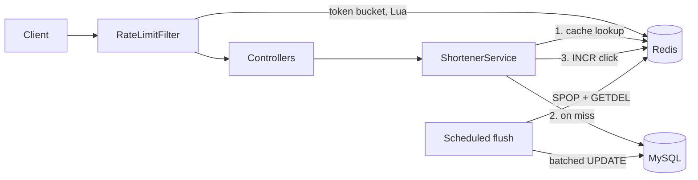

# ShortLink

A production-style **URL shortener** built with Java 17 and Spring Boot, with a **distributed
Redis token-bucket rate limiter**, cache-aside redirects and write-behind click analytics.

The interesting parts are not the CRUD. They are the design decisions on the read-heavy hot path
(redirects), the atomic rate limiter, and graceful degradation when Redis is down. See
[Design decisions](#design-decisions).

## Features

- Shorten any `http(s)` URL, optionally with a **custom alias** and **expiry** (1 to 3650 days)
- `302` redirect served from **Redis cache** (MySQL only on a cache miss)
- **Per-client rate limiting** using an atomic Redis Lua token bucket, with separate limits for
  creating and following links, plus `Retry-After` / `X-RateLimit-*` headers
- **Click analytics** counted in Redis and flushed to MySQL in batches (write-behind)
- Errors returned as RFC 7807 `application/problem+json`
- Metrics via Actuator / Micrometer (`shortlink.cache`, `shortlink.ratelimit`)
- Flyway migrations, Docker Compose, unit tests and Testcontainers integration tests

## Architecture



## Quick start

Requires Docker.

```bash
cp .env.example .env          # optional: change the passwords
docker compose up --build
./smoke-test.sh               # creates a link, follows it, shows stats, trips the rate limiter
```

Run the tests (`Testcontainers` tests are skipped automatically if Docker is unavailable):

```bash
mvn verify
```

## API

| Method | Path | Description |
|--------|------|-------------|
| `POST` | `/api/v1/urls` | Create a short link |
| `GET`  | `/{code}` | `302` redirect to the original URL |
| `GET`  | `/api/v1/urls/{code}/stats` | Click count and metadata |
| `GET`  | `/actuator/health`, `/actuator/metrics` | Health and metrics |

```bash
curl -X POST localhost:8080/api/v1/urls -H 'Content-Type: application/json' \
  -d '{"url":"https://example.com/a/very/long/path","customAlias":"my-link","expiresInDays":30}'
```

```json
{
  "shortCode": "my-link",
  "shortUrl": "http://localhost:8080/my-link",
  "originalUrl": "https://example.com/a/very/long/path",
  "createdAt": "2026-10-18T10:15:30.123456Z",
  "expiresAt": "2026-11-17T10:15:30.123456Z"
}
```

| Status | Meaning |
|--------|---------|
| `201` | Created |
| `302` | Redirect |
| `400` | Invalid URL (non-http(s), malformed) or failed validation |
| `404` | Unknown code |
| `409` | Custom alias already taken |
| `410` | Link expired |
| `429` | Rate limit exceeded; see the `Retry-After` header |

## Design decisions

**Token bucket in a Lua script.** A naive "GET counter, then SET" limiter has a race between
instances. Redis runs a Lua script atomically, so the whole refill-and-consume decision is one
indivisible step and the limit holds across any number of app instances. The bucket allows bursts up
to `capacity` while enforcing a sustained `refill-per-second` rate. Idle buckets expire on their own
(`PEXPIRE`).

**Time comes from Redis, not the app.** The script calls `redis.call('TIME')`, so clock skew
between application servers cannot give a client extra tokens.

**Fail open.** If Redis is unreachable the limiter lets traffic through (and increments a
`fail_open` metric) instead of turning a cache outage into a full outage. Redis timeouts are set to
500 ms so a slow Redis cannot stall request threads.

**Cache-aside redirects.** `GET /{code}` checks Redis first and only hits MySQL on a miss. The TTL is
`min(24h, time until the link expires)`, so an expired link is never served from cache. Every Redis
call is wrapped, so Redis is an optimisation and never a single point of failure.

**Write-behind click counting.** A redirect does a Redis `INCR` (microseconds) instead of a MySQL
`UPDATE`, which keeps the hot path off the database and avoids row-lock contention on popular links.
A scheduled job drains a set of dirty codes with `SPOP` (atomic, so multiple instances can flush
concurrently) and applies the counts with `UPDATE ... SET click_count = click_count + :n`. If the
DB write fails the counter is restored. Trade-off: the stats endpoint is eventually consistent;
it adds the not-yet-flushed Redis count to the stored value to stay accurate.

**Short codes from the database id.** The code is `Base62(id + 62^5)`. Because ids are unique, so
are codes: no collision handling, no retry loop on the common path, and codes are always at least
6 characters. Trade-off: codes are sequential and therefore guessable; if links must be unguessable,
scramble the id with a reversible permutation (e.g. multiplying by a modular inverse) before
encoding.

**Case-sensitive column.** `short_code` uses `ascii_bin`. MySQL's default collation is
case-insensitive, which would make `aB3xYz` and `ab3xyz` collide.

**302, not 301.** A `301` is cached by browsers indefinitely, so repeat visits would never reach the
server: no click counting, and expiry or deletion would stop working.

**Input validation.** Only absolute `http`/`https` URLs with a host are accepted; `javascript:`,
`data:` and `file:` are rejected. `X-Forwarded-For` is only trusted when `TRUST_PROXY=true`, because
the header is trivially spoofable and would otherwise let clients dodge the rate limiter.

**Schema owned by Flyway.** Hibernate runs with `ddl-auto: none`; migrations live in
`src/main/resources/db/migration`.

## Configuration

Everything lives in `src/main/resources/application.yml` and can be overridden by environment
variables (`DB_URL`, `DB_USER`, `DB_PASSWORD`, `REDIS_HOST`, `BASE_URL`, `TRUST_PROXY`).

```yaml
shortlink:
  cache-ttl: 24h
  rate-limit:
    create:   { capacity: 20,  refill-per-second: 0.33 }   # ~20/min, bursts of 20
    redirect: { capacity: 200, refill-per-second: 100 }
```

No secrets are committed: defaults are local-development values, and `.env` is git-ignored.

## Load testing

`loadtest/redirect.js` is a [k6](https://k6.io) script for the redirect path.

```bash
TRUST_PROXY=true docker compose up --build -d
k6 run loadtest/redirect.js
```

Measure on your own machine and record the numbers here (hardware, p95 latency, requests per
second, cache hit ratio from `/actuator/metrics/shortlink.cache`).

## Project structure

```
src/main/java/com/shortlink
  config/       typed properties, Clock and Lua script beans
  domain/       JPA entity
  repository/   Spring Data repository (atomic click increment)
  service/      ShortenerService, ClickCounter, Base62Codec, UrlValidator
  ratelimit/    RateLimiter (Redis + Lua), RateLimitFilter
  web/          controllers and problem+json error handling
src/main/resources
  scripts/token_bucket.lua
  db/migration/V1__create_short_url.sql
```

## Known limitations and next steps

- Negative caching for unknown codes (protects MySQL from enumeration scans)
- A scheduled job to delete expired rows
- Authentication and per-user link management
- Sharding or a dedicated ID generator if one MySQL instance becomes the write bottleneck
- Redis Cluster / Sentinel for high availability
